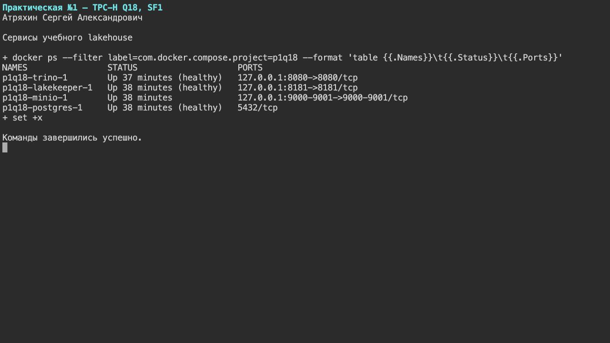
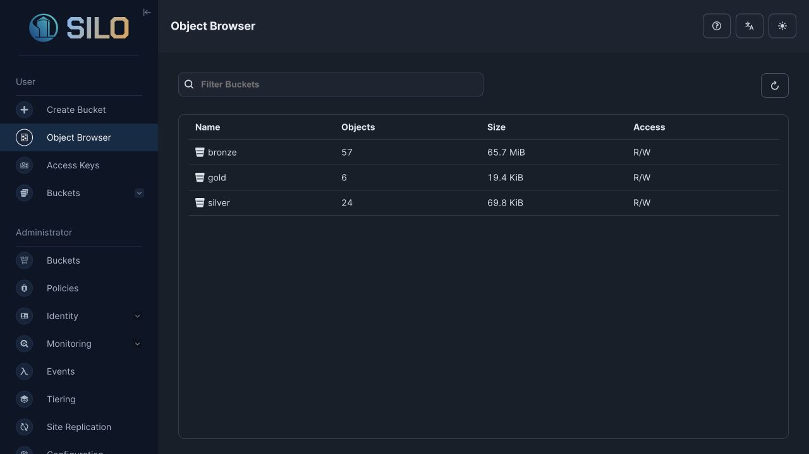
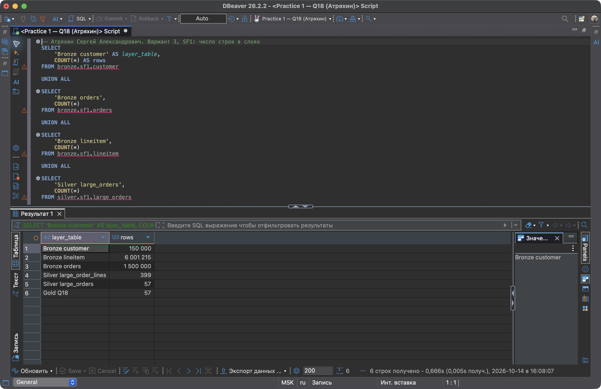
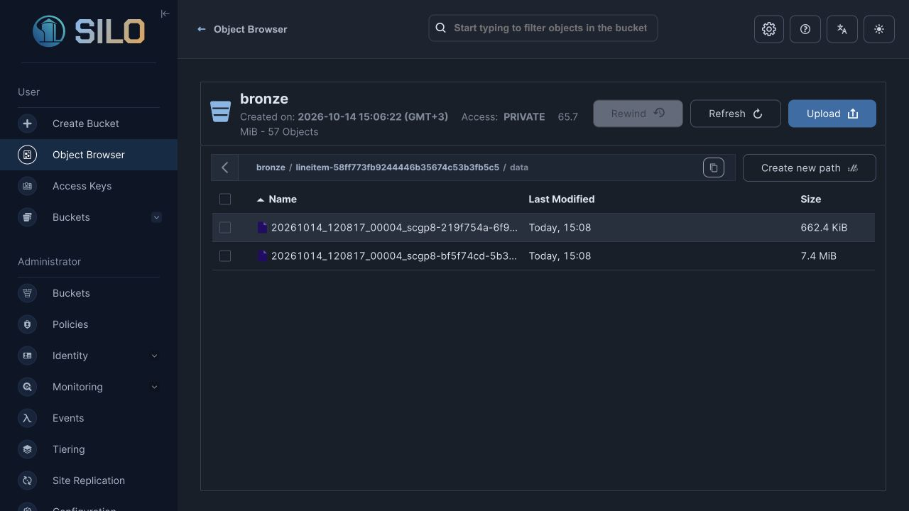
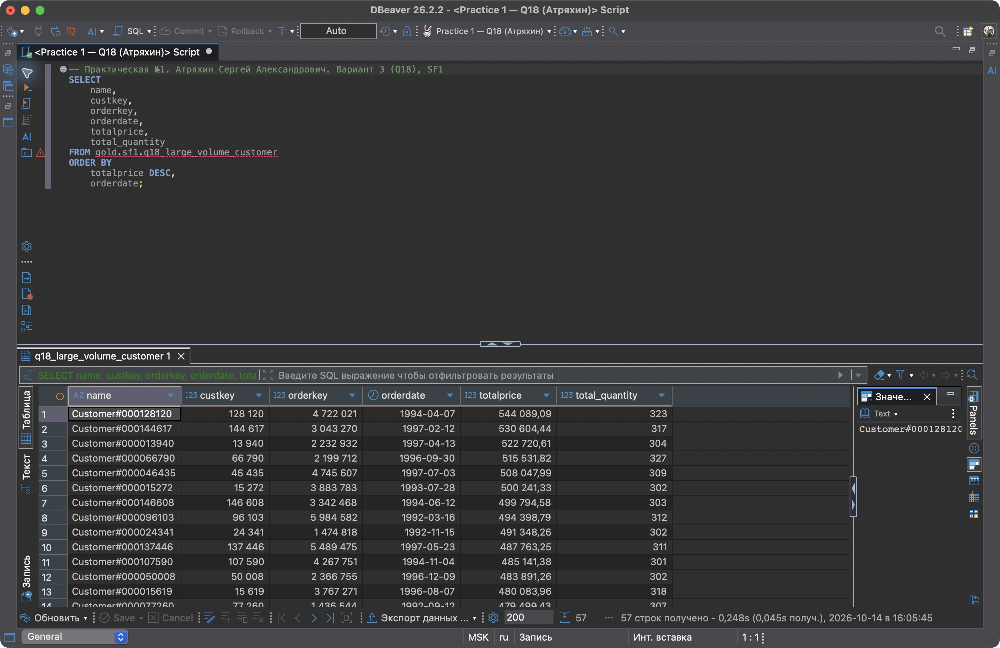
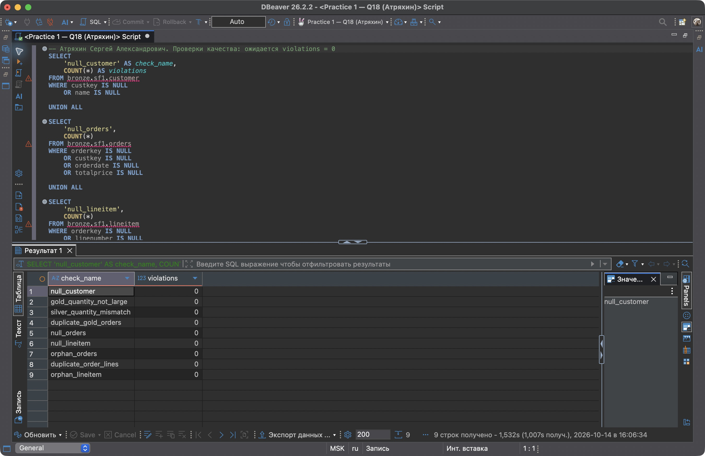
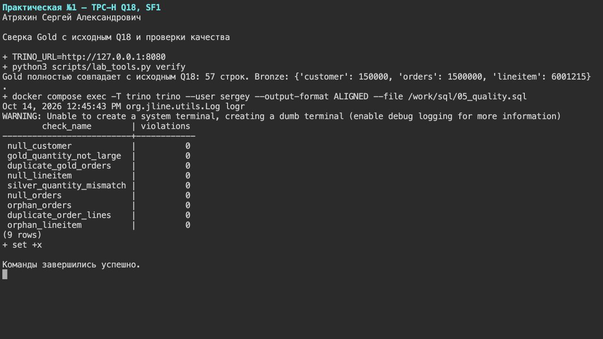
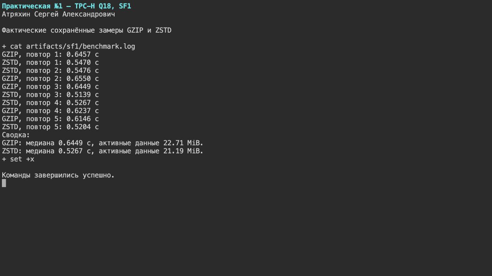
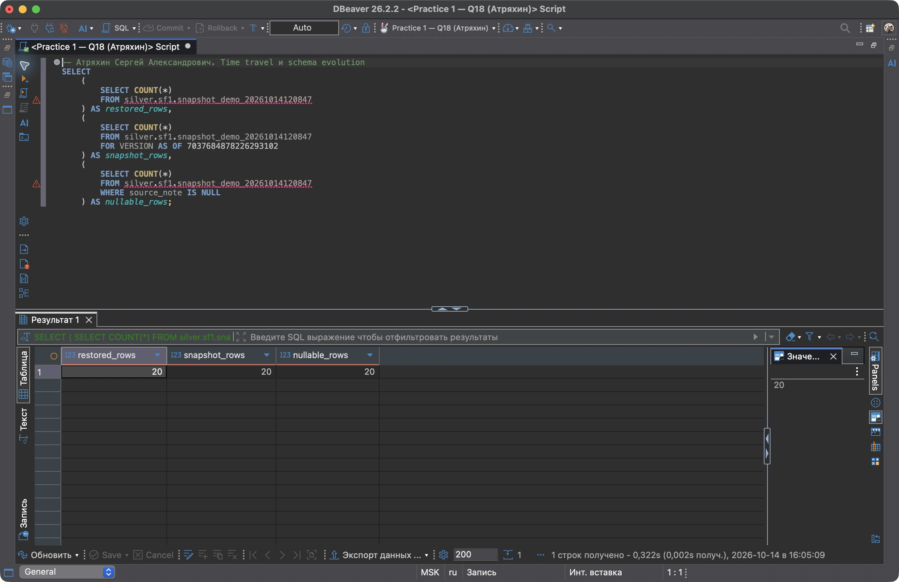
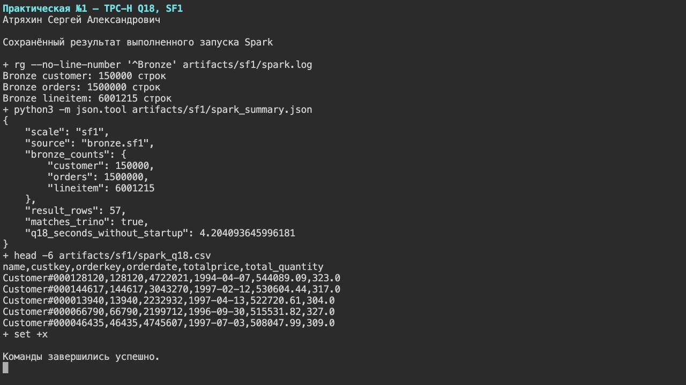

# Отчёт по практической работе №1

**Выполнил: Атряхин Сергей Александрович.**

Вариант 3 — TPC-H Q18 «Large Volume Customer», масштаб SF1. Построены слои Bronze, Silver и Gold в Apache Iceberg. Витрина содержит 57 заказов и полностью совпадает с исходным запросом; независимый запрос Spark получил тот же результат из Bronze.

Репозиторий: [sj-shoff/Practice_1_VK_Education](https://github.com/sj-shoff/Practice_1_VK_Education).

## 1. Вариант и масштаб

| Поле | Значение |
|---|---|
| ФИО (как в VK Education) | Атряхин Сергей Александрович |
| Вариант (запрос) | Вариант 3 — Q18 «Large Volume Customer» |
| Масштаб `sfN` | `sf1` |
| Почему выбрал такой масштаб | SF1 даёт 150 000 клиентов, 1 500 000 заказов и 6 001 215 позиций. Этого достаточно для соединений, агрегации и сравнения кодеков на локальном стенде. Выбранные колонки занимают около 21 MiB, поэтому можно хранить две дополнительные копии для эксперимента и повторять запрос несколько раз. |
| Окружение | macOS, Apple Silicon, 36 GiB памяти компьютера; Docker: 6 CPU, около 9,7 GiB памяти. Trino и Spark ограничены 4 GiB каждый. |
| Дата выполнения | 14 октября 2026 года |

SF1 — масштаб генератора TPC-H, а не физический размер выбранных колонок после сжатия. Один и тот же масштаб использован во всех слоях, копиях Bronze и в Spark.

## 2. Поднятые сервисы — и почему именно они

| Сервис | Образ / версия | Роль в стеке | Почему именно он |
|---|---|---|---|
| Silo, совместимый форк MinIO; сервис `minio` | `pgsty/silo:RELEASE.2026-09-03T13-18-01Z` | S3-хранилище Parquet-файлов и метаданных Iceberg | S3 API доступен обоим движкам, а веб-консоль позволяет увидеть объекты. Официальные образы MinIO не удалось получить в окружении; использован поддерживаемый совместимый форк. |
| PostgreSQL | `postgres:17` | Служебная БД Lakekeeper | Состояние каталога хранится отдельно от аналитических данных и сохраняется в Docker-томе. |
| Lakekeeper | `quay.io/lakekeeper/catalog:v0.14.0` | Iceberg REST Catalog | Trino и Spark находят одни и те же таблицы через общий REST-каталог. Не нужен отдельный каталог для каждого движка. |
| Trino | `trinodb/trino:476` | Генерация TPC-H, SQL-преобразования, проверки | Коннекторы TPC-H и Iceberg позволяют создать исходные данные и проверить медальон в одном SQL-движке. |
| Apache Spark | `apache/spark:3.5.3`, Iceberg `1.7.1` | Дополнительный движок в Docker, читает Bronze | Проверяет доступ к тем же Iceberg-таблицам независимо от Trino. Для этой задачи важнее проверить совместное чтение, чем поднимать BI-дашборд. |
| `tools` | `python:3.12-slim` | Одноразовые скрипты инициализации, сверки и замеров | Сохраняет результаты в JSON/CSV, проверяет весь ответ и выполняет повторяемый эксперимент со снимками. PyArrow 21.0.0 дополнительно проверяет фактический кодек Parquet. |
| `minio-init`, `migrate` | Образы Silo и Lakekeeper | Создание бакетов и миграция служебной БД | Готовят зависимости перед запуском каталога; оба контейнера завершились с кодом 0. |

Постоянно работают Silo, PostgreSQL, Lakekeeper и Trino. Их состояние подтверждено в [docker_ps.txt](artifacts/sf1/docker_ps.txt). Spark запущен отдельной командой `docker compose run --rm spark`, завершился успешно и оставил [лог](artifacts/sf1/spark.log) и [результат](artifacts/sf1/spark_summary.json). DBeaver — SQL-клиент на компьютере, а не дополнительный Docker-инструмент по пункту 6.2.



В хранилище созданы бакеты `bronze`, `silver`, `gold`; в Lakekeeper — одноимённые warehouses. В Trino подключены три каталога, таблицы находятся в схеме `sf1`.



### Скрипты, которыми поднял стек

Конфигурация сервисов: [compose.yaml](compose.yaml); настройки Trino: [catalog](catalog); полный порядок команд: [scripts/run.sh](scripts/run.sh).

```bash
# Хранилище, БД, миграция и REST-каталог.
docker compose up -d minio postgres lakekeeper
# Bootstrap Lakekeeper и регистрация трёх warehouses.
docker compose run --rm tools init
# SQL-движок с TPC-H и Iceberg-коннекторами.
docker compose up -d trino
# Загрузка данных и построение слоёв.
docker compose exec -T trino trino --user sergey --file /work/sql/01_bronze.sql
docker compose exec -T trino trino --user sergey --file /work/sql/02_silver_gold.sql
# Проверка результата и измерение таблиц.
docker compose run --rm tools verify
docker compose run --rm tools measure
# Две копии Bronze для сравнения сжатия.
docker compose exec -T trino trino --user sergey --file /work/sql/03_compression.sql
docker compose run --rm tools benchmark --repeats 5
# Демонстрация изменения схемы и восстановления.
docker compose run --rm tools snapshots
# Второй движок читает те же таблицы Bronze.
bash scripts/download_jars.sh
docker compose run --rm spark
```

Порты опубликованы на `127.0.0.1`: Trino `8080`, Lakekeeper `8181`, Silo `9000/9001`. Docker-тома сохраняют хранилище и служебную БД после остановки контейнеров.

## 3. Разбор запроса — какие данные нужны

| Таблица TPC-H | Нужные колонки | Что запрос с ними делает |
|---|---|---|
| `customer` | `custkey`, `name` | `custkey` соединяет клиента с заказом; оба поля входят в группировку и вывод. |
| `orders` | `orderkey`, `custkey`, `orderdate`, `totalprice` | Ключи связывают клиента, заказ и позиции. Дата и стоимость выводятся; стоимость задаёт основной порядок, дата — дополнительный. |
| `lineitem` | `orderkey`, `quantity` | Подзапрос суммирует количество по заказу и оставляет только суммы больше 300. Основной запрос соединяет позиции и снова вычисляет количество для вывода. |
| Дополнительное поле Bronze `lineitem` | `linenumber` | Не нужно самому Q18, но вместе с `orderkey` позволяет проверить уникальность позиции и сохраняет её идентификатор в Silver. |

Порог применяется к **сумме количества**, а не к числу позиций. Одна строка результата — заказ; один клиент может иметь несколько подходящих заказов. Условие строгое: `SUM(quantity) > 300`.

Исходный запрос сохранён в [sql/q18_source.sql](sql/q18_source.sql). Сортировка — `totalprice DESC, orderdate`; `LIMIT 100` задаёт максимум строк. На SF1 условию соответствуют только 57 заказов, поэтому результат содержит 57 строк.

## 4. Медальон — решения по каждому слою

Путь данных: `tpch.sf1` → исходные поля Bronze → крупные заказы и их позиции Silver → агрегированная витрина Gold.

Табличный формат — Iceberg v2; формат файлов — Parquet; кодек основных таблиц — ZSTD. Parquet позволяет читать отдельные колонки. Iceberg добавляет каталог, схемы и снимки поверх этих файлов. У запроса нет ограничения по дате; разбиение на партиции для выбранного объёма усложнило бы хранение и увеличило число мелких файлов, поэтому таблицы не партиционированы.

Размеры ниже — активные файлы данных текущего снимка: `SUM(file_size_in_bytes)` из `$files` с `content = 0`. Единица MiB равна 1 048 576 байт. Метаданные Iceberg и файлы старых снимков не включены. Полные значения в байтах, количество файлов и DDL сохранены в [layer_measurements.json](artifacts/sf1/layer_measurements.json). Формат и кодеки всех 15 активных файлов основных таблиц и двух копий Bronze проверены по Parquet footer: [parquet_codecs.json](artifacts/sf1/parquet_codecs.json).

### Bronze (сырой)

В Bronze оставлены нужные исходные колонки без фильтрации строк и изменения значений. Запись: [sql/01_bronze.sql](sql/01_bronze.sql).

| Таблица | Колонки | Строк | Вес, MiB | Формат файлов | Сжатие | Партиционирование | Обоснование |
|---|---|---:|---:|---|---|---|---|
| `bronze.sf1.customer` | `custkey`, `name` | 150 000 | 0,232287 | Parquet | ZSTD | Нет | Нужен компактный справочник клиентов; исходные значения сохранены. |
| `bronze.sf1.orders` | `orderkey`, `custkey`, `orderdate`, `totalprice` | 1 500 000 | 12,886496 | Parquet | ZSTD | Нет | Сохранены ключи соединений, стоимость и дата; лишние поля Q18 не читает. |
| `bronze.sf1.lineitem` | `orderkey`, `linenumber`, `quantity` | 6 001 215 | 8,004510 | Parquet | ZSTD | Нет | Сохранены все позиции для агрегации и проверки уникальности; Parquet и ZSTD сжимают повторяющиеся ключи. |

Основной Bronze занимает 22 149 378 байт, или 21,123293 MiB, в четырёх файлах данных: по одному для клиентов и заказов, два для позиций.





Бакет Bronze в консоли занимает больше основного Bronze: в нём находятся также обе экспериментальные копии и метаданные всех таблиц. Это другой состав измеряемых объектов.

### Silver (очищенный)

Сначала `large_orders` группирует Bronze `lineitem` и оставляет заказ с количеством больше 300. Затем `large_order_lines` соединяет эти ключи с клиентами, заказами и позициями. В ней одна строка соответствует одной позиции крупного заказа. Исходный TPC-H не содержит пропусков и нарушенных связей; это проверено, поэтому дополнительная корректировка значений не понадобилась.

| Таблица | Колонки | Строк | Вес, MiB | Формат файлов | Сжатие | Партиционирование | Обоснование |
|---|---|---:|---:|---|---|---|---|
| `silver.sf1.large_orders` | `orderkey`, `total_quantity` | 57 | 0,000778 | Parquet | ZSTD | Нет | Явно хранит отбор крупных заказов; 57 строк не требуют партиций, ZSTD сохраняет общий формат записи. |
| `silver.sf1.large_order_lines` | `name`, `custkey`, `orderkey`, `orderdate`, `totalprice`, `linenumber`, `quantity` | 399 | 0,003964 | Parquet | ZSTD | Нет | Содержит 399 подходящих позиций с нужными атрибутами; из них можно проверить и построить витрину. |

Преобразования: [sql/02_silver_gold.sql](sql/02_silver_gold.sql).

### Gold (витрина)

| Таблица | Колонки | Строк | Вес, MiB | Формат файлов | Сжатие | Партиционирование | Обоснование |
|---|---|---:|---:|---|---|---|---|
| `gold.sf1.q18_large_volume_customer` | `name`, `custkey`, `orderkey`, `orderdate`, `totalprice`, `total_quantity` | 57 | 0,002259 | Parquet | ZSTD | Нет | Агрегация по заказу и выбор до 100 строк; один небольшой файл доступен SQL-клиенту. |

Gold прочитан с явной сортировкой `ORDER BY totalprice DESC, orderdate`. Порядок записи не гарантирует порядок последующего чтения.



### Проверки результата

| Проверка | Результат |
|---|---|
| Полное совпадение Gold и исходного Q18, включая порядок | Да, 57 строк |
| NULL в обязательных колонках Bronze | 0 |
| Повторяющиеся пары `orderkey`, `linenumber` | 0 |
| Заказы без клиента, позиции без заказа | 0 |
| Заказы Gold с количеством не больше 300 | 0 |
| Повторяющиеся заказы Gold | 0 |
| Расхождения суммы количества между таблицами Silver | 0 |
| Полное совпадение Q18 Spark из Bronze с эталоном Trino | Да, 57 строк |

Проверки: [sql/05_quality.sql](sql/05_quality.sql), [verification.json](artifacts/sf1/verification.json), [quality_checks.json](artifacts/sf1/quality_checks.json).





## 5. Тесты производительности

Исходный Q18 на `tpch.sf1` выполнен отдельно: 2,3559 с от отправки запроса до получения всех строк; время Trino — 2355 мс. Идентификатор запроса и статистика: [source_query.json](artifacts/sf1/source_query.json). Этот отдельный запуск служит подтверждением выполнения исходного запроса, а сравнение кодеков проведено на файлах Bronze.

Для эксперимента созданы `bronze.sf1_gzip` и `bronze.sf1_zstd`, по три таблицы с одинаковыми полями, строками и свойствами, кроме сжатия. Основной Bronze не перезаписывался. Перед измерениями выполнено по два прогревочных запроса; затем по пять измеряемых повторов. Порядок GZIP/ZSTD чередовался. Для каждого запуска проверено полное совпадение ответа с исходным Q18.

| Сжатие Bronze | Медиана времени запроса, с | Диапазон пяти запусков, с | Размер Bronze, MiB | Вывод |
|---|---:|---:|---:|---|
| GZIP | 0.6449 | 0.6146–0.6550 | 22.707456 | Больший размер и более высокая медиана на этом стенде. |
| ZSTD | 0.5267 | 0.5139–0.5476 | 21.190535 | Меньший размер и более низкая медиана; выбран для основных слоёв. |

На этом стенде медиана ZSTD ниже на 18.3%, а размер файлов — на 6.7%. Поэтому для основных таблиц выбран ZSTD. Результат относится к SF1, выбранным колонкам и прогретому локальному окружению; он не доказывает такое же соотношение на другом оборудовании или объёме.

Время измерялось Python-клиентом через Trino REST API: от отправки SQL до получения всех страниц результата. В [benchmark_runs.csv](artifacts/sf1/benchmark_runs.csv) сохранены все 10 запусков, query ID, время клиента и `elapsedTimeMillis` Trino. Сводка: [benchmark_summary.csv](artifacts/sf1/benchmark_summary.csv); команды: [sql/03_compression.sql](sql/03_compression.sql). Незначительное различие размеров двух ZSTD-загрузок отражает отдельные записи файлов; сравнение выполнено между экспериментальными копиями.



## 6. Часть 2 — осмысление и работа с инструментами

### 6.1. Понять и объяснить

| Вопрос | Ответ |
|---|---|
| Зачем нужны большие данные и lakehouse, а не обычная БД/хранилище? | Большие данные нужны, когда объём и стоимость обработки делают работу на одной машине неудобной. Lakehouse хранит аналитические файлы в объектном хранилище, а табличный формат обеспечивает схемы, снимки и согласованные изменения. К одним таблицам можно подключить разные движки и масштабировать вычисления отдельно от хранения. Для маленькой транзакционной задачи обычная БД проще; здесь lakehouse выбран для изучения общей работы Trino и Spark. |
| Пример schema evolution на Silver: что произошло? | В отдельной копии 20 строк Silver добавлена nullable-колонка `note`, затем переименована в `source_note`. Старые строки читаются с NULL в новом поле. Пути файлов данных до и после изменения совпали: для этих операций файлы не переписывались. |
| Пример восстановления из снапшота | После удаления всех 20 демонстрационных строк текущая таблица стала пустой. `FOR VERSION AS OF` прочитал прежние 20 строк; `rollback_to_snapshot` вернул текущую таблицу к выбранному снимку. Проверены количество и полное содержимое восстановленных строк. |

Эксперимент выполнен в `silver.sf1.snapshot_demo_20261014120847`, отдельно от рабочих таблиц Silver и Gold.

| Этап | Строк |
|---|---:|
| До удаления | 20 |
| После удаления | 0 |
| Чтение исторического снимка | 20 |
| После восстановления | 20 |
| Старые строки с NULL в `source_note` | 20 |

Команды выполненного восстановления:

```sql
SELECT count(*)
FROM silver.sf1.snapshot_demo_20261014120847
FOR VERSION AS OF 7037684878226293102;

ALTER TABLE silver.sf1.snapshot_demo_20261014120847
EXECUTE rollback_to_snapshot(7037684878226293102);
```

Скрипт восстановления: [restore_snapshot.sql](artifacts/sf1/restore_snapshot.sql). Результат: [snapshot_demo.json](artifacts/sf1/snapshot_demo.json). При новом запуске демонстрации имя таблицы и ID снимка будут другими — скрипт получает и сохраняет их автоматически.



### 6.2. Подключить инструмент к lakehouse

| Инструмент | Почему выбрал именно его |
|---|---|
| Apache Spark 3.5.3 в Docker | Позволяет читать Iceberg Bronze через тот же REST-каталог и S3. В отличие от BI-клиента через Trino, это проверка чтения общих файлов вторым движком. Для локального SF1 достаточно `local[2]`; отдельный кластер Spark не нужен. |

Развёртывание Spark описано в [compose.yaml](compose.yaml), подключение — в [spark-defaults.conf](spark/spark-defaults.conf), действия — в [read_bronze.py](spark/read_bronze.py).

```bash
# Получить Iceberg runtime и S3 FileIO, проверить SHA-256.
bash scripts/download_jars.sh
# Запустить Spark с подключением к Lakekeeper и Silo.
docker compose run --rm spark
```

В консоли Spark выполнены следующие действия:

1. Подключён каталог `bronze` к `http://lakekeeper:8181/catalog`; S3 FileIO — к `http://minio:9000`.
2. Подсчитаны строки клиентов, заказов и позиций: 150 000, 1 500 000 и 6 001 215.
3. Через `show(10, False)` выведены первые позиции Bronze с сортировкой по `orderkey`, `linenumber`.
4. Исходный Q18 выполнен над `bronze.sf1`, без обращения к Trino.
5. Все 57 строк сравнивались с эталоном; ответ совпал. Время выполнения Q18 без запуска Spark — 4,2041 с.

Подтверждения: [spark.log](artifacts/sf1/spark.log), [spark_summary.json](artifacts/sf1/spark_summary.json), [spark_q18.csv](artifacts/sf1/spark_q18.csv). Время Spark — отдельный запуск, оно не включено в сравнение кодеков Trino.



## 7. Выводы

В Bronze я сохранил исходные поля и все строки, в Silver выделил крупные заказы и их позиции, а в Gold получил 57 заказов для Q18. Сверка с TPC-H и независимое чтение Spark подтвердили, что преобразования сохранили результат запроса. В проведённом сравнении ZSTD дал меньший размер и более низкую медиану времени, поэтому я выбрал его для основных слоёв. Iceberg позволил добавить и переименовать колонку без переписывания файлов и восстановить данные после удаления. Для этого объёма партиционирование не потребовалось, а общий REST-каталог обеспечил доступ двух движков к одним таблицам.

## Материалы выполнения

SQL, конфигурация, скрипты, JSON/CSV, логи и снимки экрана включены в проект. Сохранены текстовые логи и десять снимков экрана: четыре из DBeaver, два из Silo и четыре из консоли. Снимки консоли получены через браузерный терминал [ttyd](https://github.com/tsl0922/ttyd), который выполняет shell-команды в PTY. Проверки Q18 и список сервисов запущены при съёмке; для замеров и Spark показаны сохранённые результаты выполненных запусков. Скрипт съёмки: [console_proof.sh](scripts/console_proof.sh). Файлы данных находятся в Docker-томах и не включены в Git — они воспроизводятся из TPC-H коннектора.

За основу инфраструктуры взят [предоставленный пример](https://github.com/1KrAiDoN1/Practice_1_VK_Education). В этой работе используются собственный вариант Q18, его SQL-преобразования, проверки и фактически полученные результаты. Описание технологий сверено с [документацией Silo](https://github.com/pgsty/silo), [Iceberg connector Trino 476](https://github.com/trinodb/trino/blob/476/docs/src/main/sphinx/connector/iceberg.md) и [настройками Iceberg для Spark](https://iceberg.apache.org/docs/1.7.1/spark-configuration/).
